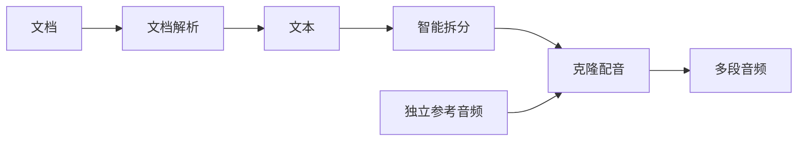

# 从完整文案生成多段复刻配音

配套版本：主仓库 `feat/reusable-voice-workflow`，OpenAI 插件
`feat/speech-safe-splitting`。Qwen Audio 插件沿用已有版本。

## 搭建一次，反复使用



1. 添加「文档」，上传 TXT、Markdown 或 DOCX，连接「文档解析」，选择
   OpenAI 插件并执行。得到的「文本」就是原文。也可以直接从「文本」输入开始，
   粘贴文案。TXT、MD、DOCX 在本机提取，不调用模型。
2. 将文本右侧出口拖到「智能拆分」左侧文本入口。选择 OpenAI 插件；百炼兼容
   端点可以填写自己的文本模型（例如 `qwen-plus`），或留空沿用设置。
3. 分段用途选「语音配音」，目标模型选 Qwen Audio。默认目标 45 秒、估算
   4 字/秒、每段上限 400 字。想要短段可改为 25 秒、上限 180 字。慢语速、
   英文、停顿多时应进一步减少字数，时长仅为估计。
4. 点击「执行」。程序会核对所有分段拼接后与原文逐字相同，包括标点、空白
   和顺序。模型改写、漏字或重排会使执行失败，不会把改稿结果继续用于配音。
   过长段落优先在句末，其次在分句或自然停顿处分开。
5. 添加或继续使用原有「生成语音（克隆音色）」节点，选择 Qwen Audio。
   **将智能拆分节点自己的右侧文本出口直接连接到克隆节点文本入口。**
   以后从 14 段变成 4 段时会自动传递当前全部分段，无须重新逐段接线。
   已有多个独立文本节点接同一个克隆节点的方式也保留。
6. 从此前上传或生成的独立「音频」节点右侧拖线，连接克隆节点左侧的
   「参考音频」入口。鼠标停在入口可查看名称。声音和文本入口分开显示。
   节点显示实际声音文件及来源节点，可以试听。
7. 点击「生成语音」。分段共用这一条参考声音。结果按原文顺序显示每段原文、
   参考声音、状态、播放器和下载按钮。任务完成先后不会改变对应顺序。输出
   音频节点也保留全部成功音频，供其他节点复用。
8. 左上角菜单选择「保存」。以后从「我的工作流」打开；也可切换执行模式，
   点击播放并确认，执行整条工作流。图、参数和配音结果会一起保存。

智能拆分和 Qwen Audio 合成使用外部服务，真实执行可能计费。

## 调整参考声音

- 两种旧版克隆节点都能直接连入参考音频，不需要删掉重建。
- 连线优先于本节点上传的声音。连入后上传／录音按钮暂不可用，避免改了本地
  声音却仍使用连线声音造成误解。
- 要断开，拖动已有连线端点到空白画布，再确认「删除」。重新拖线即可换声。
- 没有连线时可以直接上传、录音或清除本地参考声音。断线后若恢复本地声音，
  节点会明确显示它来自本节点。
- 连线存在但上游音频为空或过期时，不会退回本地旧声音继续执行。

Qwen Audio 的公开限制为每条参考不超过 30 秒、10 MB，支持 WAV、MP3、OGG Opus。
其他格式是否能转换取决于本机 FFmpeg。

## 修改原文后怎样重做

- 修改上游文本或替换文件重新解析后，旧分段会失效；先重新拆分，再生成配音。
  克隆节点不会把创建时复制的历史文字当作当前输入。
- 断开文本连线后，克隆节点没有当前文本，不能继续用旧文字生成。
- 在解析／拆分得到的文本节点里打开全屏编辑并保存，文本会标记为「已手工
  编辑」，成为后续使用的手工文案。重跑上游会另建结果，不覆盖手工稿；整条
  工作流执行也继续读取手工稿。
- 原文、分段或参考声音改变后，旧配音显示为「历史配音」，可以试听，重新生成
  才得到当前输入对应的音频。
- 新分段减少后，多出的旧输出节点保留空壳和连线，历史内容不再进入新任务。
  原有文件素材不会因此删除。
- 很早保存的解析／拆分结果缺少来源记录，首次打开可能提示重新执行。保留原图，
  重新执行一次即可建立来源记录。

## 模型限制与验证边界

Qwen Audio 3.1 TTS-Next 的提示词上限是 3000 字符，普通配音单次输出上限
是 120 秒。语音分段模式预留提示词空间，并按估算语速留出 20 秒余量。
估计时长不能保证实际输出符合目标。换其他模型可选「其他模型」并设置其字数上限。
限制依据：[模型说明](https://help.aliyun.com/en/model-studio/qwen-audio-3-1-tts-next)、
[音频生成 API](https://help.aliyun.com/zh/model-studio/audio-generation-api)。

自动验收中的百炼文本和音频返回由本地接口模拟，输出是可播放的测试音，
不是真实声音复刻样本。参考声音由本机系统合成，不含私人声音。真实模型的
语义分段质量、克隆相似度、读音、漏读、截尾与生成时长须在授权调用后另行确认。

## 复验

准备项目依赖、两个插件、插件 Python 环境、Chrome、Puppeteer Core、FFmpeg，
以及本机 `say` 的 Tingting 测试声音后运行：

```bash
pnpm test
pnpm typecheck
pnpm --filter tongflow typecheck
pnpm verify:plugins
PYTHONDONTWRITEBYTECODE=1 PYTHONPATH="$PWD/sdk" \
  data/.tongflow/plugin-venv/bin/python -m unittest discover \
  -s plugins/tongflow-api-openai/tests -v
pnpm build
PUPPETEER_MODULE=/absolute/path/to/puppeteer-core/lib/puppeteer/puppeteer-core.js \
  node scripts/verify-speech-workflow.mjs
```

脚本使用独立浏览器、新数据库、本地模拟接口和随机无效凭据。截图、模拟请求、
原文、分段、工作流和下载哈希写入 Git 忽略的 `.tongflow/speech-workflow/browser-*/`。
不会改写现有工作流、素材或设置。现有文档与下载功能可继续用
`scripts/verify-audio-documents.mjs` 回归。
